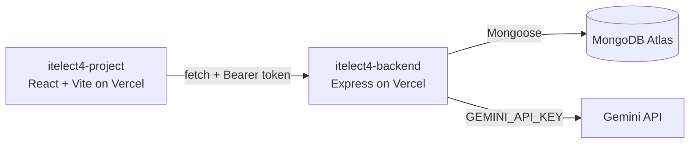

# itelect4-backend

The REST API behind the ITELECT4 class demo: Express in TypeScript,
MongoDB Atlas through Mongoose, JWT login, and one route that asks
Gemini to review a project description.

## Live

- **Backend:** https://itelect4-backend-nine.vercel.app
- **Frontend:** https://itelect4-project-three.vercel.app

## Architecture

## Tests

`npm test` runs the Supertest suite in `tests/` against the real
Express app, with the database replaced and Gemini never called.
GitHub Actions runs it on every push (`.github/workflows/ci.yml`).

