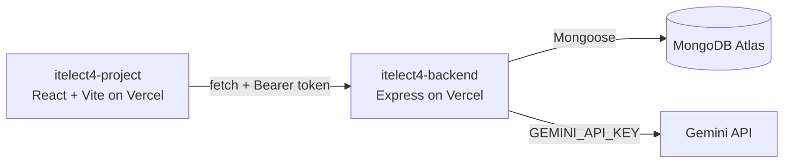

# itelect4-backend

[](https://github.com/JBenjo/itelect4-backend/actions/workflows/ci.yml)

The REST API behind the ITELECT4 class demo: Express in TypeScript,
MongoDB Atlas through Mongoose, JWT login, and one route that asks
Gemini to review a project description.

## Live

- **Backend:** https://itelect4-backend-nine.vercel.app
- **Frontend:** https://itelect4-project-three.vercel.app

## Architecture



## Run locally

```bash
git clone https://github.com/JBenjo/itelect4-backend.git
cd itelect4-backend
npm install
cp .env.example .env   # then fill in MONGODB_URI, JWT_SECRET, GEMINI_API_KEY, CORS_ORIGIN
npm run dev            # API on http://localhost:4000
```

- `npm run seed` — load the sample courses once.
- `npm test` — the Supertest suite (no server, no database needed).

## Tests

`npm test` runs the Supertest suite in `tests/` against the real
Express app, with the database replaced and Gemini never called.
GitHub Actions runs it on every push (`.github/workflows/ci.yml`).

## AI-use disclosure

This repository was built with the help of an AI coding assistant, used
across Sessions 1 to 12 for scaffolding, explanations and debugging.
Every line was reviewed before being committed, and the author can
explain how it works. The Gemini AI review feature (`POST /api/ai`) is
part of the ITELECT4 coursework itself.

